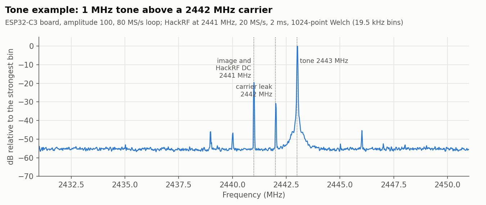
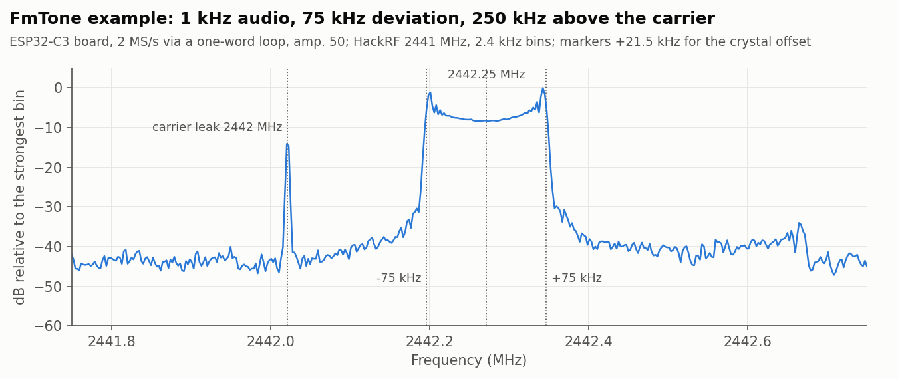
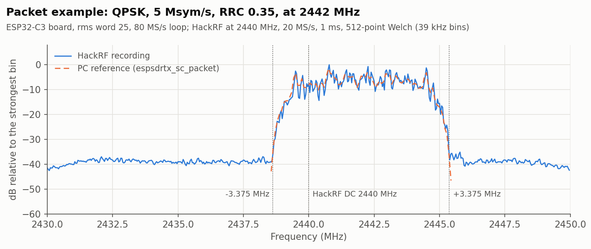

# ESP32-C3

The Wi-Fi PHY's DAC replay engine, found by experiment (Espressif does not
document it; ESP32-DATV drives the same engine). The registers and the libphy
calls are described at the top of `port.c`.

| | |
|---|---|
| Loop | up to 16383 words of 10-bit I and Q, at 40 or 80 MS/s |
| Sample bank | 0x3fcb0000; the whole 128 KiB 0x3fca0000..0x3fcbffff is reserved from the heap |
| CPU | 160 MHz RISC-V, no FPU: streams run at 160 MHz / period samples per second |
| Tuning | 2400 to 2483.5 MHz; out of band (opt-in) 2175 to 2790 MHz, where the PLL locked |
| Filter modes | 0: 21 MHz within 2 dB; 1: measured the same as 0; 2: about 35 MHz within 3 dB |
| Toolchains | ESP-IDF 5.5, Arduino-ESP32 3.2.0 (IDF 5.4) |

## Boards tested

| Board | Chip | Measured |
|---|---|---|
| ESP32-C3 SuperMini (40 MHz crystal, 4 MB flash, chip antenna) | QFN32, rev v0.4 | Loop playback, all packet modulators and streams on air; the tuning range; the carrier leak and its DC correction |

## Known behaviour

- Output compresses from a word of about 256 at 40 MS/s and 128 at 80 MS/s.
- The carrier leaks through at -27 to -37 dBc (a tone of amplitude 100 at
  80 MS/s), about -44 dBc with the DC correction; the correction differs per
  board and rate.
- Writing into a playing loop longer than 4 words loses stores or puts them in
  the wrong place, so the library refuses writes while the loop plays.
- On some boots the AM stream runs slightly slower than on others: at the
  shortest periods it otherwise keeps up with (48 cycles), nearly every
  sample then comes late. The same firmware after a reset can be fine. The
  cause is still being looked into; leave some margin in the period.

## Recordings

[`captures/`](captures) holds short HackRF recordings of the examples running
on the board above (esptool read the chip as QFN32, rev v0.4, 40 MHz crystal,
4 MB embedded flash), recorded the same way as the ESP32-C6's
([`../esp32c6/README.md`](../esp32c6/README.md#recordings)), so the two sets
can be compared side by side. They are in [SigMF](https://sigmf.org):
`.sigmf-data` is interleaved int8 I/Q (`ci8`) at 20 MS/s as `hackrf_transfer`
writes it, and `.sigmf-meta` gives the centre frequency, the HackRF's gains
and what was transmitting. They were taken over the air (no cable) with the
HackRF's amplifier off, at LNA 16 dB and VGA 20 dB except the packet (LNA
32 dB, VGA 30 dB: this board's signal arrived about 20 dB weaker than the
C6's at the same gains, and the board placement was not controlled, so the
levels are relative and say nothing about either chip's power).

| File | What | HackRF centre | Signal |
|---|---|---|---|
| `tone_2443MHz_esp32c3` | Tone example, 2 ms | 2441 MHz | tone at +2 MHz, carrier leak at +1 MHz |
| `fmtone_2442.25MHz_esp32c3` | FmTone example, 2 ms (two cycles of the 1 kHz audio) | 2441 MHz | FM centred at +1.25 MHz, ±75 kHz |
| `packet_qpsk_2442MHz_esp32c3` | Packet example, 1 ms (25 loops of 40 µs) | 2440 MHz | QPSK centred at +2 MHz |
| `packet_qpsk_reference.cs16` | the same packet loop built on a PC by `espsdrtx_sc_packet` | - | int16 I/Q at 80 MS/s, 3200 samples |

**Crystal offset:** this board's carrier ran about 21.5 kHz high against the
HackRF (about 9 ppm; the C6 board was within 1 kHz), so every line in these
recordings sits that much above its nominal frequency. It only shows at the
FmTone image's scale, whose markers are moved to match. A receiver has to
allow for it: an offset estimated from one 40 µs loop to the next is only
known modulo 25 kHz, and taking the wrong wrap made the packet look
undecodable until the tone recording gave the true offset.

### Spectra

Each image is the averaged spectrum (Welch, Hann window) of the recording
beside it, plotted against the RF frequency and in dB relative to the
strongest bin shown. Dotted lines mark the frequencies named on them.

**Tone** ([`tone_2443MHz_esp32c3.png`](captures/tone_2443MHz_esp32c3.png)):
the tone at 2443 MHz and the carrier leak at 2442 MHz about 31 dB down. The
image would be at 2441 MHz, under the HackRF's own DC spike, so it cannot be
read here; with the HackRF tuned 3 MHz lower the same board gave an image of
-34 dBc and a leak of -37 dBc. The narrow lines at 2439, 2440 and 2446 MHz
also appear in the C6 recording, so they are probably not from either ESP;
they were not identified.



**FmTone** ([`fmtone_2442.25MHz_esp32c3.png`](captures/fmtone_2442.25MHz_esp32c3.png)):
the FM signal fills 2442.175 to 2442.325 MHz (plus the crystal offset),
flat with horns at the edges, as a sine tone at 75 kHz deviation should;
the stream sent 20,000,001 samples in 10 s with none late. The carrier leak
is -23 dBc of the FM signal's total power, the same as on the C6 in the
same example. The pedestal 35 to 40 dB down and the small line near
2442.67 MHz look the same as in the C6 recording and were not looked into.



**Packet** ([`packet_qpsk_2442MHz_esp32c3.png`](captures/packet_qpsk_2442MHz_esp32c3.png)):
the QPSK packet's root-raised-cosine spectrum, 6.75 MHz wide (2438.625 to
2445.375 MHz), about 35 dB over the floor. The dashed line is the spectrum
of `packet_qpsk_reference.cs16`, the same loop built on a PC, shifted to the
recording's level and drawn only across the packet band. Compared sample by
sample, the recording's 20 loops averaged correlate 0.986 with the reference
(EVM 17 %, 100 loops of a longer capture: 24 %; the C6 gave 10 to 11 %), and
every QPSK decision matches.



### Reading the files

Any SigMF reader opens them; with NumPy:

```python
import numpy as np
raw = np.fromfile("tone_2443MHz_esp32c3.sigmf-data", dtype=np.int8)
iq = (raw[0::2] + 1j * raw[1::2]) / 128
```
