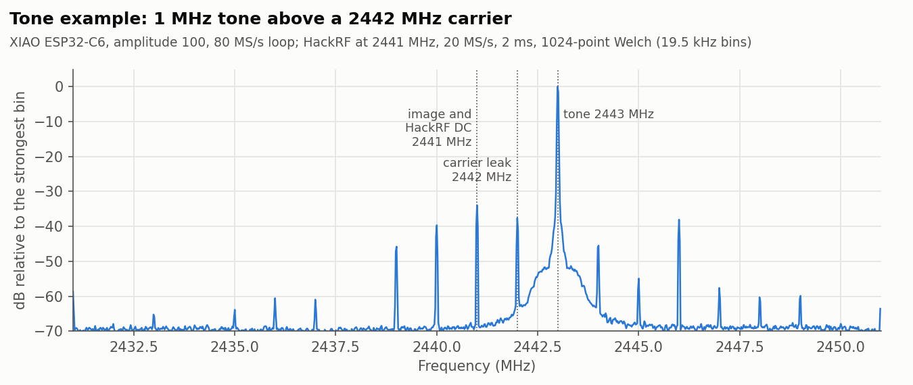
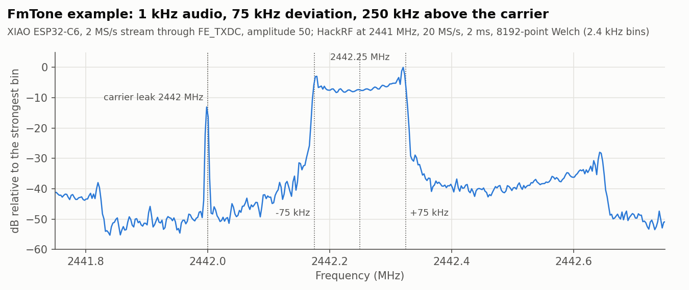
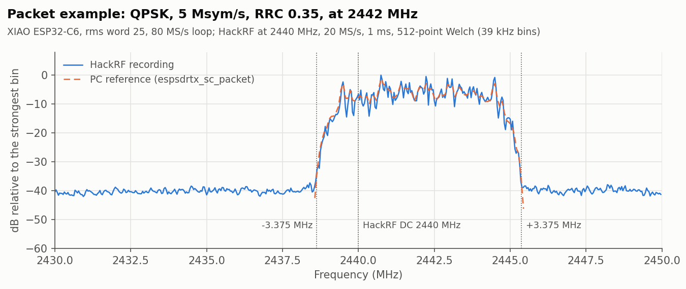

# ESP32-C6

The modem's DAC replay engine, at other addresses than on the C3. The
registers come from cyber-murmel's
[esp-sdr-zephyr](https://github.com/cyber-murmel/esp-sdr-zephyr)
(`doc/undocumented-registers-esp32c6.md`); what the port does with them, and
why, is described at the top of `port.c`. Everything below was measured with a
HackRF One over the air (no cable, no attenuator).

| | |
|---|---|
| Loop | up to 16383 words of 10-bit I and Q, at 40 or 80 MS/s |
| Sample bank | 0x40840000, SRAM block 2; the whole 128 KiB 0x40840000..0x4085ffff is reserved from the heap |
| Streams | written to the front end's TX DC register (`FE_TXDC`, 0x600a0444), not the bank: the CPU cannot store into the bank while the engine owns it |
| CPU | 160 MHz RISC-V, no FPU: streams run at 160 MHz / period samples per second |
| Tuning | 2400 to 2483.5 MHz. Out of band is not tried yet, so `espsdrtx_allow_out_of_band` adds nothing on the C6 |
| Filter modes | 0 to 2 accepted as on the C3; all measured the same: flat within 1 dB to ±10 MHz, -10 dB at ±13 MHz, -19 dB at ±15 MHz |
| Toolchains | Arduino-ESP32 3.2.0 (IDF 5.4). The ESP-IDF build is not tried yet (`idf.py set-target esp32c6`) |

## Differences from the C3

- **TX on:** libphy's `force_txon_mode(1, 0, index)` turns the transmitter on;
  the pbus calls alone do not. The index is a power index, 0 the strongest
  and about 1 dB weaker per step; the port uses 0.
- **PLL tracking:** ESP-IDF's `phy_track_pll` timer (every second) releases the
  TX force, so a loop went silent within 3 s. The port stops the timer while a
  loop plays and starts it again afterwards. Streams run with interrupts off,
  so the timer cannot fire during one.
- **Modem clocks:** the engine needs the MODEM_SYSCON clocks forced on, or it
  runs but nothing reaches the antenna. The port forces them only while a loop
  plays and restores them after.
- **Streams:** the C3 streams by rewriting a one-word loop in the bank. On the
  C6 the engine shuts the CPU out of its bank, so streams write `FE_TXDC`,
  which drives the DAC directly in the same I/Q format (`HW_STREAM_WORD`).

## Boards tested

| Board | Chip | Measured |
|---|---|---|
| Seeed Studio XIAO ESP32C6 (40 MHz crystal, 4 MB flash, on-board ceramic antenna; Arduino board `XIAO_ESP32C6`) | ESP32-C6FH4 (QFN32), rev v0.2 | Loop at 80 and 40 MS/s, all five examples on air (Tone, Packet decoded, FmTone, AmTone, PmTone), tuning across the ISM band, filter modes, the carrier leak, stream rates |

## Known behaviour

Measured on the XIAO, tuned to 2442 MHz unless noted:

- **Loop:** a 1 MHz tone of amplitude 100 at 80 MS/s came out 70 to 77 dB
  over the HackRF's floor; image -52 dBc, carrier leak -42 to -46 dBc without
  DC correction (-26 dBc on channel 1, 2412 MHz). 40 MS/s put the same loop at
  +0.5 MHz, as expected. A loop played steadily for over 30 s.
- **Tuning:** the tone landed where expected (within the few kHz of crystal
  offset between the boards) at 2402, 2412, 2437.5, 2455.25, 2472 and
  2481.5 MHz, so kHz offsets between channels work.
- **Packet:** the Packet example (QPSK, 5 Msym/s) matched the waveform the
  same modulator builds on a PC: correlation 0.995, EVM 10 % (100 loops
  averaged), every QPSK decision the same.
- **Streams:** FmTone, AmTone and PmTone (2 MS/s, period 80) ran 10 s each with
  16 to 35 of 20 million samples late. A period of 48 still nearly kept up
  (1527 of 10 million late), 40 did not.
- **Stream carrier leak:** the leak grew with the stream rate: about
  -31 dBc at 400 kS/s and -16 dBc at 2 MS/s (a constant-frequency stream,
  amplitude 100), as if each write to `FE_TXDC` added a little DC. In a
  coarse test `espsdrtx_set_dc` did not reduce it. It may not be the C6's
  alone: in the FmTone example the leak was -23 dBc of the FM signal's power
  on both the C6 and the C3, and the C3's leak against stream rate has not
  been measured. Keep the signal offset from the carrier, as the examples do
  (250 kHz).
- **Level:** output rose 6 dB from amplitude 100 to 200 and only 1 dB from 250
  to 511, so it compresses from about 200.
- **XIAO with its on-board antenna:** a carrier or loop amplitude above about
  200 at full power (231 and 250 did, 200 did not) drops the board off USB,
  and the host's reconnect resets it. With the RF switch on the U.FL connector (GPIO14 high) amplitude 511
  played without a reset, so it is the antenna's own field reaching the USB
  lines, not the chip. Keep amplitudes at 200 or less with the ceramic
  antenna, or use the U.FL connector. The Arduino variant powers the RF switch
  (GPIO3 low) and selects the ceramic antenna (GPIO14 low) before `setup()`.
- **Serial output after a stream:** with interrupts off for seconds, USB
  serial output queued just before or after a stream can arrive late, after
  the next output.

## Recordings

[`captures/`](captures) holds short HackRF recordings of the examples running
on the XIAO, in [SigMF](https://sigmf.org): `.sigmf-data` is interleaved int8
I/Q (`ci8`) at 20 MS/s as `hackrf_transfer` writes it, and `.sigmf-meta`
gives the centre frequency, the HackRF's gains and what was transmitting.
They were taken over the air (no cable), with the HackRF at LNA 16 dB and
VGA 20 dB and its amplifier off, so levels are relative, not calibrated.

| File | What | HackRF centre | Signal |
|---|---|---|---|
| `tone_2443MHz_xiao_esp32c6` | Tone example, 2 ms | 2441 MHz | tone at +2 MHz, carrier leak at +1 MHz |
| `fmtone_2442.25MHz_xiao_esp32c6` | FmTone example, 2 ms (two cycles of the 1 kHz audio) | 2441 MHz | FM centred at +1.25 MHz, ±75 kHz |
| `packet_qpsk_2442MHz_xiao_esp32c6` | Packet example, 1 ms (25 loops of 40 µs) | 2440 MHz | QPSK centred at +2 MHz |
| `packet_qpsk_reference.cs16` | the same packet loop built on a PC by `espsdrtx_sc_packet` | - | int16 I/Q at 80 MS/s, 3200 samples |

The HackRF's own DC spike sits at 0 Hz in each recording, which is why the
centre was set below the ESP's carrier.

### Spectra

Each image is the averaged spectrum (Welch, Hann window) of the recording
beside it, plotted against the RF frequency and in dB relative to the
strongest bin shown. Dotted lines mark the frequencies named on them.

**Tone** ([`tone_2443MHz_xiao_esp32c6.png`](captures/tone_2443MHz_xiao_esp32c6.png)):
the tone at 2443 MHz and the carrier leak at 2442 MHz about 37 dB down. The
image would be at 2441 MHz, under the HackRF's own DC spike (34 dB down), so
it cannot be read here; measured with the HackRF tuned elsewhere it was
-52 dBc (above).
The narrow lines at whole MHz either side, 35 to 60 dB down, were not
identified (the ESP's spurs or the HackRF's).



**FmTone** ([`fmtone_2442.25MHz_xiao_esp32c6.png`](captures/fmtone_2442.25MHz_xiao_esp32c6.png)):
the FM signal fills 2442.175 to 2442.325 MHz, flat with horns at the
edges, as a sine tone at 75 kHz deviation should. The carrier leak at
2442 MHz is about 13 dB under the peak bin (the stream leak described
above). The pedestal about 35 to 40 dB down, from 2442.1 to 2442.65 MHz,
has not been looked into.



**Packet** ([`packet_qpsk_2442MHz_xiao_esp32c6.png`](captures/packet_qpsk_2442MHz_xiao_esp32c6.png)):
the QPSK packet's root-raised-cosine spectrum, 6.75 MHz wide (2438.625 to
2445.375 MHz), about 35 dB over the floor. The dashed line is the
spectrum of `packet_qpsk_reference.cs16`, the same loop built on a PC,
shifted to the recording's level: it is drawn only across the packet band,
and follows the recording's ripple bin for bin, because the loop repeats
the same 3200 samples.



### Reading the files

Any SigMF reader opens them; with NumPy:

```python
import numpy as np
raw = np.fromfile("tone_2443MHz_xiao_esp32c6.sigmf-data", dtype=np.int8)
iq = (raw[0::2] + 1j * raw[1::2]) / 128
```
